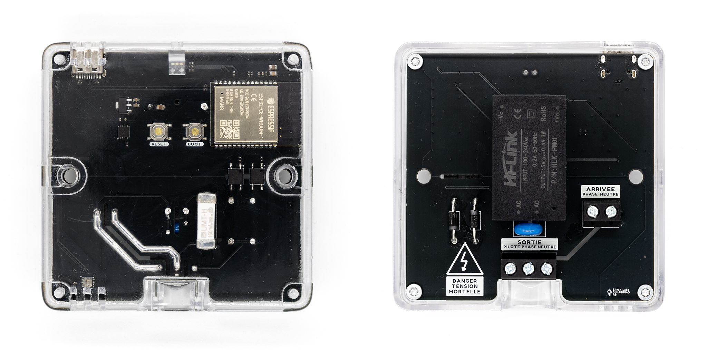

# ESPHome Electric Heater Pilot Module

ESPHome firmware for the Sitron Labs SLHA00045 module, a smart Wi-Fi module for controlling electric heaters through Home Assistant using the French _fil pilote_ (pilot wire) system.

🛒 Buy now at:
- [Sitron Labs official store](https://www.sitronlabs.com/r/slha00045-gh)

## Overview

This module turns any fixed electric heater compatible with the French pilot wire ([_fil pilote_](https://fr.wikipedia.org/wiki/Chauffage_%C3%A9lectrique#Fil_pilote)) system into a smart, connected device. It mounts directly onto the heater's junction box, replacing the existing cover, and lets your home automation system control heating and monitor room temperature and humidity.

On power-up, and after any power loss, the module defaults to frost protection to avoid unwanted heating and protect the installation.

This product is designed for the French market, where the pilot wire system is used.

## What is ESPHome?

[ESPHome](https://esphome.io/) is an open source framework that turns microcontrollers into smart home devices through simple configuration files. It integrates natively with [Home Assistant](https://www.home-assistant.io/) and also works with any system that supports its API, making it easy to add and maintain custom devices on your network.

## Features

* Based on an ESP32-C6 microcontroller with Wi-Fi
* Pilot wire (_fil pilote_) control: comfort and frost protection modes
* AHT20 temperature and humidity sensor
* Green LED heating indicator
* Native Home Assistant integration over the ESPHome API
* Over-the-air (OTA) firmware updates
* Easy Wi-Fi setup via ESPHome Improv or captive portal
* Automatic frost protection on power-up
* Open firmware and schematic

## Installation

### Wiring

> [!WARNING]
> This module works with 230 V AC mains voltage. Installation must be performed exclusively by persons with the necessary electrical qualifications. Always disconnect power and verify the absence of voltage before working on the installation. This module has no certification; use at your own risk.

The module screws onto the heater's junction box in place of the existing cover (you can reuse the existing cover's screws). Two wires come into the board from the mains: live and neutral. Three wires go out to the heater: live and neutral are passed through, and the module adds the pilot wire (_fil pilote_) signal it generates.

### Wi-Fi setup

On first power-up, you need to provide the device with your Wi-Fi credentials. This step is called provisioning, and can be done in several ways:

1. **Bluetooth (BLE) via Home Assistant** — If your Home Assistant instance has Bluetooth, the device should appear automatically on the [Integrations page](https://my.home-assistant.io/redirect/integrations/). Follow the wizard to enter your Wi-Fi credentials.
2. **USB (serial) via the ESPHome web interface** — Connect the device to your computer with a USB cable, open [web.esphome.io](https://web.esphome.io/) and click _Connect_, then select the device (usually shown as _USB JTAG/serial debug unit_). From the device menu (…), choose _Configure Wi-Fi_ → _Connect to Wi-Fi_, select your network and enter the password.
3. **Fallback access point (captive portal)** — When the device can't connect to a Wi-Fi network, it starts a fallback hotspot whose name begins with `SLHA00045`. Connect to it and follow the captive portal to configure Wi-Fi. If the portal doesn't open automatically, browse to <http://192.168.4.1/>.

### Home Assistant

Once connected to your network, the module is auto-discovered by Home Assistant as an ESPHome device, where it appears as a thermostat (heat / off) and a temperature and humidity sensor.

## Support

* Browse and raise [GitHub Issues](https://github.com/sitronlabs/SLHA00045-Firmware-ESPHome/issues)
* Ask questions in our [Discord server](https://discord.gg/btnVDeWhfW)
